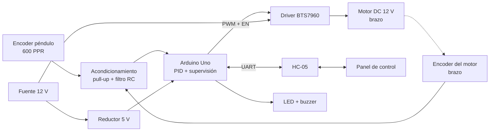
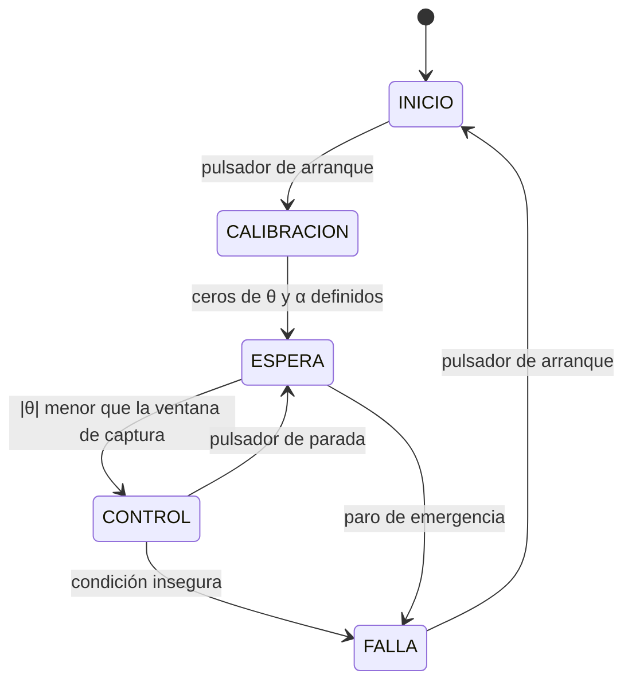

# Sistema embebido de control para un péndulo invertido rotatorio (RotPen) basado en Arduino

**Proyecto de aula – Sistemas Embebidos**
**Avance 2 – Corte 2**

| Campo | Información |
| --- | --- |
| Integrantes | [Javier Lizarazo, Jesús Acuña, Bladimir Parra] |
| Docente | [COMPLETAR] |
| Institución | Corporación Universidad de la Costa (CUC) |
| Fecha de entrega | [14/10/2026] |
| Repositorio | [COMPLETAR enlace de GitHub o GitLab] |

---

## Tabla de contenido

1. Título y objetivos
2. Planteamiento del problema
3. Introducción
4. Estado del arte
5. Marco teórico
6. Listado de materiales
7. Componente técnico
8. Verificación de la metodología y del cronograma
9. Estado del prototipo frente a los entregables
10. Referencias

---

## 1. Título y objetivos

### 1.1 Título del proyecto

**Diseño e implementación de un sistema embebido de control para un péndulo invertido rotatorio (RotPen) basado en Arduino, con tarjeta de circuito impreso propia.**

### 1.2 Objetivo general

Diseñar e implementar un prototipo embebido basado en Arduino capaz de estabilizar un péndulo invertido rotatorio en su posición de equilibrio vertical superior mediante un controlador PID, integrando acondicionamiento electrónico, supervisión de seguridad y transmisión de variables en tiempo real sobre una tarjeta de circuito impreso (PCB) propia.

### 1.3 Objetivos específicos

1. Diseñar y construir la estructura mecánica y la PCB del sistema, que integren las etapas de acondicionamiento de señales, de potencia y de control, a partir de los requisitos y de la arquitectura seleccionada en el Avance 1.
2. Implementar y sintonizar sobre el Arduino un controlador PID con periodo de muestreo fijo y una rutina de supervisión embebida que garantice la operación segura del motor.
3. Desarrollar el módulo de transmisión de variables hacia un panel de control con visualización en tiempo real y validar el desempeño del sistema frente a los requisitos no funcionales definidos (error en estado estacionario, tiempo de establecimiento y respuesta ante perturbaciones).

---

## 2. Planteamiento del problema

El péndulo invertido rotatorio es un sistema subactuado, no lineal y de equilibrio inestable: un único motor, que gira un brazo horizontal alrededor de un eje vertical, debe controlar de forma indirecta dos grados de libertad, la posición angular del brazo (α) y el ángulo del péndulo respecto a la vertical (θ). Sin una acción de control permanente, el péndulo abandona su posición vertical superior en fracciones de segundo.

El problema se agrava cuando el control debe ejecutarse sobre un microcontrolador de recursos limitados (Arduino Uno, arquitectura de 8 bits a 16 MHz) que, además del lazo de control, debe leer dos encoders en cuadratura, generar la señal PWM del motor, supervisar condiciones inseguras y transmitir variables al computador. Cualquier retardo introducido por estas tareas, el ruido en las señales de los encoders, la fricción o las holguras mecánicas deterioran la estabilidad del sistema. Adicionalmente, la interconexión mediante cables y protoboard resulta poco fiable en un sistema con dinámica rápida, por lo que se requiere una integración física robusta del hardware.

Con base en lo anterior, se plantea la siguiente pregunta de investigación:

> ¿Cómo diseñar un sistema embebido basado en Arduino, con electrónica de acondicionamiento, etapa de potencia y PCB propias, que permita estabilizar de forma segura un péndulo invertido rotatorio en su posición vertical superior y transmitir sus variables de operación en tiempo real?

---

## 3. Introducción

Los sistemas de control con dinámica inestable son un banco de pruebas habitual en la formación de ingeniería electrónica, porque obligan a integrar sensado, procesamiento en tiempo real, electrónica de potencia y diseño de hardware en un solo producto. Entre ellos, el péndulo invertido rotatorio, conocido también como péndulo de Furuta, destaca por su alta no linealidad y su bajo costo de construcción frente a otras plataformas didácticas.

Este documento presenta el segundo avance del proyecto de aula. En el primer avance se definieron los requisitos funcionales y no funcionales, se analizó el problema, se compararon tres arquitecturas y se seleccionó la Opción A: motorreductor DC de 12 V con encoder incremental, acople por polea, driver de potencia tipo puente H y Arduino como controlador. En este avance se desarrolla el diseño electrónico detallado (acondicionamiento de señales, etapa de potencia, alimentación, comunicación y supervisión), el diseño de la PCB, el diseño de la estructura y la arquitectura del firmware, y se verifica el cumplimiento de la metodología y del cronograma.

El documento se organiza así: las secciones 1 y 2 formalizan los objetivos y el problema; las secciones 3 a 5 presentan la introducción, el estado del arte y el marco teórico; la sección 6 lista los materiales; la sección 7 desarrolla el componente técnico; las secciones 8 y 9 verifican el avance del proyecto; y la sección 10 reúne las referencias.

> **Nota sobre el formato:** en todo el documento los títulos, las tablas y las ilustraciones están numerados. Los marcadores `[COMPLETAR]` indican información propia del grupo que debe diligenciarse antes de la entrega.

---

## 4. Estado del arte

El péndulo invertido rotatorio fue propuesto por Furuta y colaboradores en el Instituto de Tecnología de Tokio a comienzos de los años noventa, junto con una estrategia de levantamiento (swing-up) basada en realimentación de pseudoestados [1]. Desde entonces, la plataforma se ha estudiado con distintas estrategias de control. Åström y Furuta propusieron el levantamiento del péndulo mediante control de energía y su captura posterior con un controlador lineal [2]. Cazzolato y Prime publicaron una derivación detallada y verificada de la dinámica del péndulo de Furuta, base de numerosos modelos posteriores [3]. En la literatura se reportan además controladores PID y PD, reguladores lineales cuadráticos (LQR), control por modos deslizantes y control difuso, siendo los controladores lineales los más empleados para la fase de estabilización alrededor del equilibrio superior.

En el ámbito comercial y académico existen plataformas completas, como la familia de péndulos rotatorios de Quanser [9], que integran motor, encoders y software de control, pero con costos elevados. Frente a ellas, abundan las implementaciones didácticas de bajo costo con Arduino, motor DC y encoders incrementales, que sacrifican precisión mecánica a cambio de accesibilidad, y que son el punto de partida de este proyecto.

**Tabla 1. Trabajos relacionados y aporte al proyecto**

| Referencia | Aporte | Relación con este proyecto |
| --- | --- | --- |
| Furuta et al., 1992 [1] | Origen del péndulo rotatorio y primer esquema de swing-up | Define la configuración mecánica adoptada |
| Åström y Furuta, 2000 [2] | Levantamiento por control de energía y captura lineal | Base para una futura rutina de levantamiento automático |
| Cazzolato y Prime, 2011 [3] | Modelo dinámico verificado del péndulo de Furuta | Fuente del modelo para el marco teórico y la sintonía |
| Quanser [9] | Plataforma comercial de referencia | Referencia de desempeño y de instrumentación |
| Video y repositorio de referencia del grupo | [COMPLETAR: título, autor y enlace] | Referencia funcional de la implementación con Arduino |

**Aportes diferenciales de este proyecto:** (i) PCB propia con separación de tierras de lógica y potencia, (ii) supervisión embebida de seguridad independiente del enlace de comunicación, y (iii) arquitectura modular que admite sensores adicionales, como una IMU, sin rediseñar la tarjeta.

---

## 5. Marco teórico

### 5.1 Dinámica del péndulo invertido rotatorio

Sea α el ángulo del brazo, θ el ángulo del péndulo medido desde la vertical superior y q = [α θ]ᵀ. Aplicando el método de Euler–Lagrange, la dinámica se expresa en la forma general:

$$M(q)\,\ddot{q} + C(q,\dot{q})\,\dot{q} + G(q) = \begin{bmatrix}\tau \\ 0\end{bmatrix}$$

donde M es la matriz de inercia, C agrupa los efectos de Coriolis y centrífugos, G el efecto de la gravedad y τ el par que el motor aplica al brazo. La segunda componente es nula porque el péndulo no tiene actuador propio, lo que caracteriza al sistema como subactuado. El desarrollo completo de las matrices en función de las masas, longitudes e inercias se encuentra en [3].

Linealizando alrededor del equilibrio superior (α = 0, θ = 0), con vector de estado x = [α θ α̇ θ̇]ᵀ, se obtiene el modelo:

$$\dot{x} = A\,x + B\,u$$

La matriz A tiene un valor propio real positivo, lo que confirma la inestabilidad del punto de equilibrio. Como referencia de orden de magnitud, la frecuencia natural del péndulo aproximado como masa puntual de longitud l es ω = √(g/l); para l entre 0,15 m y 0,20 m resulta entre 7,0 y 8,1 rad/s, es decir, del orden de 1,1 a 1,3 Hz. Esto fija la exigencia de muestreo del lazo de control (sección 7.11).

### 5.2 Motor DC y puente H

El motor DC se describe con las ecuaciones:

$$V = R_a\, i + K_e\, \omega, \qquad \tau = K_t\, i$$

donde V es la tensión aplicada, Rₐ la resistencia de armadura, K_e la constante de fuerza contraelectromotriz, K_t la constante de par, i la corriente y ω la velocidad angular. La tensión media aplicada mediante PWM es aproximadamente V ≈ D · V_bus, con D el ciclo útil. Un puente H permite invertir la polaridad y, con ello, el sentido de giro. La corriente de bloqueo del motor, I_bloq = V_bus / Rₐ, es la corriente máxima que deben soportar la fuente, el fusible, las pistas y el driver.

### 5.3 Encoder incremental en cuadratura

Un encoder en cuadratura entrega dos señales (A y B) desfasadas 90°. Contando todos los flancos de ambas señales (decodificación 4x) se obtiene una resolución de:

$$\Delta\theta = \frac{360^\circ}{4 \cdot PPR}$$

Para un encoder de 600 PPR, Δθ = 360° / 2400 = 0,15° por cuenta. Esta resolución es muy inferior al error en estado estacionario objetivo de ±2° (RNF02). El sentido de giro se obtiene del orden de los flancos.

### 5.4 Controlador PID discreto

La ley de control en tiempo discreto, con periodo de muestreo T, es:

$$u[k] = K_p\, e[k] + K_i\, T \sum_{j=0}^{k} e[j] + K_d\,\frac{e[k]-e[k-1]}{T}$$

con e[k] = θ_ref − θ[k] y θ_ref = 0°. En la implementación se emplean las prácticas habituales [5]: saturación de u, anti-windup del término integral y derivada calculada sobre la medición con filtro de primer orden para reducir el ruido. Dado que el péndulo controla únicamente θ, el brazo puede derivar hasta sus límites; por ello se prevé un lazo adicional de realimentación sobre α (acción proporcional-derivativa de baja ganancia) sumado a la salida del PID del péndulo.

### 5.5 Tiempo real en el ATmega328P

El Arduino Uno emplea el microcontrolador ATmega328P [6], con dos entradas de interrupción externa (INT0 e INT1, pines D2 y D3) e interrupciones por cambio de pin (PCINT) en los demás pines. Se dispone de tres temporizadores: Timer0 (usado por `millis()`), Timer1 (16 bits) y Timer2 (8 bits). Un sistema con dos encoders en cuadratura requiere cuatro líneas con interrupción, por lo que se emplean INT0/INT1 para el encoder del péndulo (variable más rápida y crítica) y PCINT para el encoder del brazo.

### 5.6 Compatibilidad electromagnética y protección

El motor genera ruido conducido y transitorios por la conmutación del puente H y por la energía almacenada en su inductancia. Las medidas de mitigación empleadas son: condensadores de desacople y de bulto cerca del driver, diodo supresor de transitorios (TVS) en el bus de 12 V, filtros RC en las señales de los encoders, separación de los retornos de tierra de potencia y de lógica con unión en un único punto, y fusible en la entrada de potencia.

---

## 6. Listado de materiales

**Tabla 2. Listado de materiales del prototipo**

| N.º | Componente | Cant. | Especificación | Función | Valor de referencia (COP) |
| --- | --- | --- | --- | --- | --- |
| 1 | Arduino Uno R3 | 1 | ATmega328P, 16 MHz | Controlador principal | 55.000 |
| 2 | Motorreductor DC con encoder | 1 | 12 V, encoder integrado | Actuador del brazo | 70.000 |
| 3 | Encoder incremental en cuadratura | 1 | 600 PPR, 5 V | Medición de θ | 60.000 |
| 4 | Módulo driver puente H BTS7960 | 1 | 43 A máx. del integrado | Etapa de potencia | 35.000 |
| 5 | Módulo Bluetooth HC-05 | 1 | UART, lógica de 3,3 V | Transmisión inalámbrica | 25.000 |
| 6 | Fuente conmutada | 1 | 12 V / 3 A | Alimentación de potencia | 40.000 |
| 7 | Módulo regulador reductor 12 V a 5 V | 1 | Tipo LM2596, 3 A | Alimentación lógica | 8.000 |
| 8 | Rodamientos de bolas | 2 | [COMPLETAR diámetros] | Eje de articulación | 20.000 |
| 9 | Perfil y lámina de aluminio | 1 juego | Brazo, péndulo, columna | Estructura | 45.000 |
| 10 | Base y gabinete en acrílico o MDF | 1 | Corte láser | Estructura | 35.000 |
| 11 | Piezas impresas en PLA | 1 juego | Acoples y soportes | Mecánica | 30.000 |
| 12 | Fabricación de PCB | 1 | 2 capas, FR4 1,6 mm, cobre de 1 oz | Integración electrónica | 60.000 |
| 13 | Conectores, cables y tornillería | 1 lote | Bornes de tornillo, cabezales | Interconexión | 30.000 |
| 14 | Pulsador de paro de emergencia (NC) | 1 | Normalmente cerrado | Seguridad | Por cotizar |
| 15 | Pulsador de arranque y calibración | 1 | Normalmente abierto | Interfaz de usuario | Por cotizar |
| 16 | LED verde y LED rojo | 2 | 5 mm | Indicación de estado | Por cotizar |
| 17 | Buzzer activo de 5 V | 1 | Frecuencia fija | Alerta sonora | Por cotizar |
| 18 | Transistor NPN 2N2222 | 1 | TO-92 | Manejo del buzzer | Por cotizar |
| 19 | Diodo TVS | 1 | Tipo SMBJ15A | Protección del bus de 12 V | Por cotizar |
| 20 | Fusible con portafusible | 1 | 3 A (ajustar según I_bloq) | Protección de sobrecorriente | Por cotizar |
| 21 | Diodo Schottky | 1 | Tipo 1N5822, 3 A | Protección de polaridad inversa | Por cotizar |
| 22 | Condensador electrolítico | 1 | 1000 µF / 25 V | Bulto del bus de 12 V | Por cotizar |
| 23 | Condensadores cerámicos | 8 | 100 nF (desacople) | Desacople | Por cotizar |
| 24 | Condensadores cerámicos | 2 | 10 nF | Filtros de encoders | Por cotizar |
| 25 | Resistencias 1/4 W | Lote | 330 Ω, 1 kΩ, 2 kΩ, 10 kΩ | Pull-up, divisor, limitación | Por cotizar |
| 26 | Cabezales hembra para shield | 1 juego | Formato Arduino UNO R3 | Conexión con el Arduino | Por cotizar |

El valor de referencia de los ítems 1 a 13 proviene del presupuesto del Avance 1 (total ≈ 513.000 COP). Los ítems adicionales deben cotizarse antes de la compra y sumarse al presupuesto.

---

## 7. Componente técnico

### 7.1 Arquitectura general del sistema

El sistema se divide en cuatro bloques: sensado, control, potencia y comunicación/supervisión. La PCB se diseña como una **tarjeta tipo shield para Arduino Uno R3** (68,6 mm × 53,3 mm), que se acopla sobre el microcontrolador y concentra el acondicionamiento, las protecciones, los conectores y la interfaz del usuario. El módulo BTS7960 se conecta a la PCB mediante cabezal y el motor y los encoders mediante bornes de tornillo.



*Figura 1. Diagrama de bloques del sistema.*

> **Figura requerida:** además del diagrama anterior, incluir en `docs/img/` el diagrama de bloques elaborado a mano o con software de diseño gráfico (por ejemplo, draw.io), con el mismo contenido.

### 7.2 Asignación de pines

**Tabla 3. Asignación de pines del Arduino Uno**

| Función | Pin | Característica utilizada | Observación |
| --- | --- | --- | --- |
| Encoder del péndulo, canal A | D2 | INT0 | Decodificación 4x por interrupción externa |
| Encoder del péndulo, canal B | D3 | INT1 | Decodificación 4x por interrupción externa |
| Encoder del brazo, canal A | A0 | PCINT8 | Interrupción por cambio de pin (puerto C) |
| Encoder del brazo, canal B | A1 | PCINT9 | Interrupción por cambio de pin (puerto C) |
| PWM sentido directo (RPWM) | D9 | OC1A, Timer1 | PWM de aproximadamente 20 kHz |
| PWM sentido inverso (LPWM) | D10 | OC1B, Timer1 | PWM de aproximadamente 20 kHz |
| Habilitación del driver (R_EN y L_EN) | D7 | Salida digital | Con resistencia de pull-down a GND |
| Lectura del estado de habilitación | D12 | Entrada digital | Detecta el paro de emergencia |
| Pulsador de arranque y calibración | D5 | Entrada con pull-up interna | Activo en bajo |
| LED verde (operación normal) | D4 | Salida digital | Resistencia de 330 Ω |
| LED rojo (falla) | D8 | Salida digital | Resistencia de 330 Ω |
| Buzzer (vía transistor) | D6 | Salida digital | Transistor 2N2222 |
| Sensor de corriente R_IS | A2 | Entrada analógica | Ver sección 7.4 |
| Sensor de corriente L_IS | A3 | Entrada analógica | Ver sección 7.4 |
| UART hacia HC-05 | D0 (RX), D1 (TX) | Hardware UART | Con puentes de desconexión para programación |
| Reservado para IMU (I²C) | A4, A5 | SDA, SCL | Cumple el RNF05 de modularidad |
| Libres | D11, D13 | — | Expansión |

Se emplea el UART por hardware para el HC-05 porque una emulación por software (`SoftwareSerial`) deshabilita interrupciones durante la recepción y perturbaría la lectura de los encoders. Los puentes JP1 y JP2 desconectan D0 y D1 del HC-05 durante la programación por USB.

### 7.3 Acondicionamiento de los encoders

Cada canal de encoder (cuatro en total) recibe el mismo tratamiento:

- Resistencia de pull-up de 10 kΩ a 5 V, necesaria si el encoder tiene salidas de colector abierto y inocua si son de tipo push-pull.
- Filtro RC pasa bajos con R = 1 kΩ en serie y C = 10 nF a tierra, junto al pin del Arduino.
- Frecuencia de corte: f_c = 1 / (2π · R · C) = 1 / (2π · 1000 · 10×10⁻⁹) ≈ 15,9 kHz.

**Verificación del filtro.** La frecuencia máxima de la señal se estima para una velocidad angular de 2 rev/s del péndulo: f = 600 PPR × 2 rev/s = 1,2 kHz, muy inferior a 15,9 kHz, por lo que el filtro no distorsiona la señal. La constante de tiempo τ = R · C = 10 µs es mucho menor que el ancho mínimo de un estado de la señal (un cuarto de periodo ≈ 208 µs), por lo que no se pierden flancos. El filtro atenúa el ruido de conmutación del motor, de frecuencia muy superior.

Cada conector de encoder dispone de cuatro terminales: 5 V, GND, A y B. Se coloca un condensador de 100 nF entre 5 V y GND junto a cada conector.

### 7.4 Etapa de potencia

El driver BTS7960 (módulo de doble medio puente) recibe las señales RPWM, LPWM, R_EN, L_EN, VCC y GND de la PCB, y entrega la potencia al motor.

- **Modo de operación:** para el sentido directo se aplica PWM en RPWM y LPWM en cero; para el inverso, a la inversa. Nunca se aplica PWM en ambas entradas a la vez.
- **Frecuencia de PWM:** el Timer1 se configura en modo PWM de fase correcta con ICR1 como valor máximo. Para una frecuencia f_PWM = f_clk / (2 · N · ICR1) con N = 1 y ICR1 = 400, resulta f_PWM = 16 MHz / (2 · 400) = 20 kHz, fuera del rango audible. La resolución es de 400 niveles (aproximadamente 8,6 bits).
- **Habilitación segura:** las líneas R_EN y L_EN se unen en un único nodo EN. El pin D7 alimenta ese nodo a través del pulsador de paro de emergencia normalmente cerrado (NC), y el nodo EN lleva una resistencia de pull-down de 10 kΩ a GND. Con ello el driver permanece deshabilitado durante el arranque o reinicio del Arduino (pines en alta impedancia) y también al presionar el paro de emergencia, de forma independiente del firmware.
- **Sensado de corriente:** los pines R_IS y L_IS entregan una corriente proporcional a la corriente de carga (relación típica del orden de 8500:1 según el fabricante [7]). Con una resistencia de 1 kΩ a GND, como la que incorporan habitualmente estos módulos, 3 A producen aproximadamente 0,35 V, es decir, unos 40 mA por cuenta del conversor de 10 bits. Esta relación debe validarse con el esquema del módulo adquirido. Cada línea lleva un filtro RC de 1 kΩ y 100 nF hacia su entrada analógica.
- **Protecciones del bus de 12 V:** fusible de 3 A (ajustar según la corriente de bloqueo del motor seleccionado, I_bloq = V / Rₐ), diodo Schottky en serie para polaridad inversa, diodo TVS de 15 V en paralelo con el bus, condensador electrolítico de 1000 µF / 25 V cercano al driver y condensador cerámico de 100 nF en paralelo.
- **Ancho de pistas de potencia:** según IPC-2221 [8], para 3 A, un aumento de temperatura de 10 °C y cobre externo de 1 oz, el área requerida es de aproximadamente 74 mil², equivalente a un ancho mínimo cercano a 1,4 mm. Se adopta un ancho de **2 mm** como margen de seguridad. Las pistas de señal usan 0,3 mm.

### 7.5 Alimentación

- **Etapa de potencia (12 V):** la fuente de 12 V / 3 A alimenta únicamente el driver y el motor, a través del fusible, el diodo de polaridad y los condensadores descritos.
- **Etapa lógica (5 V):** un módulo reductor de 12 V a 5 V alimenta el Arduino, los encoders, el HC-05 y los indicadores. Se prefiere un reductor conmutado al regulador lineal interno del Arduino, porque este último disiparía (12 V − 5 V) × I, con una corriente lógica estimada de 100 a 150 mA, es decir, de 0,7 a 1,05 W de calor adicional en la placa.
- **Tierras:** se separan los retornos de potencia (motor y driver) y de lógica (Arduino y sensores) y se unen en **un solo punto** (conexión en estrella) a la entrada de la fuente, para que las corrientes del motor no circulen por la referencia de las señales.
- **Alcance de la separación:** el diseño realiza separación de planos de tierra, no aislamiento galvánico. La redacción del RF02 del Avance 1 debe leerse en ese sentido; si se desea aislamiento galvánico real, habría que añadir optoacopladores rápidos en las líneas de PWM, lo cual queda como mejora futura.
- **Programación por USB:** para evitar la competencia entre la alimentación por USB y la del reductor de 5 V, no se conecta el cable USB mientras la fuente de 12 V esté encendida, salvo que se instale un diodo Schottky en serie con la salida del reductor.

### 7.6 Comunicación con el HC-05

El HC-05 usa lógica de 3,3 V en su entrada RXD, mientras que el TX del Arduino entrega 5 V. Se coloca un divisor resistivo de 1 kΩ (serie) y 2 kΩ (a GND):

$$V_{RXD} = 5\,\text{V} \cdot \frac{2\,\text{k}\Omega}{1\,\text{k}\Omega + 2\,\text{k}\Omega} \approx 3{,}33\ \text{V}$$

La salida TXD del HC-05 (3,3 V) se conecta directamente al RX del Arduino, ya que supera el umbral de nivel alto del microcontrolador. La velocidad de comunicación es de 115 200 baudios (cada byte ocupa 10 bits ≈ 87 µs), configurada previamente mediante comandos AT, pues el módulo trae por defecto 9600 baudios. La trama de telemetría propuesta, a 50 Hz, es una línea de texto separada por comas:

```
t_ms,theta,alpha,u,sp,Kp,Ki,Kd\n
```

Con unos 40 bytes por trama, el tráfico es de aproximadamente 2000 B/s, muy inferior a los 11 520 B/s que admite el enlace.

### 7.7 Supervisión y señalización

El firmware ejecuta, en cada ciclo de control, las siguientes verificaciones, independientes del enlace de comunicación (RF06):

1. |θ| mayor que el rango de captura (por ejemplo, 25°): se desactiva el motor y se registra la falla.
2. |α| mayor que el límite mecánico de giro del brazo: se desactiva el motor.
3. Corriente medida por encima del umbral durante más de un tiempo definido: se desactiva el motor.
4. Estado de la línea de habilitación (D12) incoherente con el comando: se declara falla de seguridad.

Ante una falla, el LED rojo se enciende, suena el buzzer y el sistema permanece en estado de falla hasta que se presione el pulsador de arranque. El LED verde indica operación normal. Los valores de umbral se definirán en las pruebas de la sección 7.12.

**Buzzer:** el buzzer activo consume cerca de 30 mA, que excede lo que conviene extraer de un pin del Arduino, por lo que se maneja con un 2N2222. Con una resistencia de base de 1 kΩ, I_B = (5 V − 0,7 V) / 1 kΩ ≈ 4,3 mA, valor que satura el transistor con holgura (con β ≥ 100 podría conducir más de 400 mA). **LED:** I = (5 V − 2 V) / 330 Ω ≈ 9 mA.

### 7.8 Esquemático y diseño de la PCB

**Esquemático.** Se elabora en un programa de diseño electrónico (KiCad o EasyEDA) con las siguientes hojas o secciones: (1) conexión al Arduino Uno y asignación de pines, (2) acondicionamiento de encoders, (3) conexión del driver con habilitación y paro de emergencia, (4) alimentación y protecciones, (5) comunicación HC-05, (6) indicadores y pulsadores.

*Figura 2. Esquemático completo de la PCB.* → `docs/img/fig02-esquematico.png`

**Diseño de la PCB (layout).** Reglas de diseño adoptadas:

- 2 capas, FR4 de 1,6 mm, cobre de 1 oz; contorno del formato shield Arduino Uno R3.
- Plano de tierra de lógica y plano de tierra de potencia separados, unidos en un único punto cerca del conector de la fuente.
- Pistas de potencia de 2 mm; pistas de señal de 0,3 mm; separación mínima de 0,3 mm, ajustada a las capacidades del fabricante elegido.
- Condensadores de desacople lo más cerca posible de los pines de alimentación de cada conector.
- Filtros RC de encoders junto a las entradas del Arduino; resistencias de pull-up junto a los conectores.
- Zona de potencia (fusible, TVS, bulto, conector del driver) en un borde de la tarjeta, alejada de las entradas de encoder.
- Bornes de tornillo para motor, fuente y encoders; serigrafía con nombre y polaridad de cada conector.
- Orificios de montaje para fijar la PCB a la estructura.

*Figura 3. Layout de la PCB (capas superior e inferior).* → `docs/img/fig03-layout-pcb.png`
*Figura 4. Vista 3D de la PCB.* → `docs/img/fig04-pcb-3d.png`

**Lista de verificación previa a la fabricación:** ejecutar DRC y ERC sin errores, confirmar huellas con los componentes físicos, revisar la polaridad de condensadores y diodos, verificar que el pull-down del nodo EN esté presente y que ningún pin de potencia comparta pista con una señal.

### 7.9 Diseño de la estructura y del gabinete

Se conservan las dimensiones preliminares del Avance 1 con los siguientes ajustes de verificación:

- **Altura de la columna:** con un péndulo de 15 a 20 cm que cuelga libremente por debajo del brazo, una columna de 15 cm haría que el péndulo toque la base. Se debe verificar que la altura del eje del brazo sobre la base sea mayor que la longitud del péndulo más una holgura (aproximadamente 25 cm para un péndulo de 20 cm), o bien limitar el recorrido del péndulo con topes mecánicos.
- **Barrido del brazo:** con un brazo de 15 cm, el barrido es un círculo de 30 cm de diámetro, mayor que la base de 20 cm × 20 cm. Se debe confirmar que el barrido no choque con el gabinete ni con los cables.
- **Gabinete:** caja de acrílico o MDF para la PCB, el módulo BTS7960 y la fuente, con aberturas para el conector de alimentación, el pulsador de paro de emergencia accesible, el pulsador de arranque y los indicadores.
- **Protección del usuario:** el brazo gira con un motor de 12 V; se recomienda un tope mecánico de giro y no manipular el sistema en funcionamiento.

*Figura 5. Plano de la estructura con dimensiones (vistas frontal, lateral y superior).* → `docs/img/fig05-estructura.png`
*Figura 6. Distribución interna del gabinete.* → `docs/img/fig06-gabinete.png`

### 7.10 Integración mecánica de sensores

El encoder del péndulo se acopla al eje de articulación con un adaptador impreso en PLA y rodamientos de bajo rozamiento, con el fin de no introducir un par de fricción que se sume a la dinámica del péndulo. El encoder del brazo es el integrado en el motorreductor. La resolución del encoder del brazo es:

$$CPR_{brazo} = 4 \cdot PPR_{motor} \cdot N_{reduccion}$$

donde N_reduccion es la relación del reductor (y de la polea, si la hay) entre el eje del encoder y el eje del brazo. [COMPLETAR con los datos del motorreductor adquirido.]

### 7.11 Arquitectura del firmware

Aunque la programación final no es exigida en este avance, la arquitectura se define para dimensionar el hardware.

**Periodo de muestreo.** Se emplea una interrupción periódica del Timer2 en modo CTC con prescaler de 1024: la frecuencia del contador es 16 MHz / 1024 = 15 625 Hz; con OCR2A = 77 el periodo es (77 + 1) / 15 625 ≈ 4,99 ms, es decir, T ≈ 5 ms (200 Hz). Esta frecuencia es más de cien veces la frecuencia natural del péndulo (≈ 1,2 Hz), lo que satisface el requisito RNF01.

**Carga de CPU (estimación a verificar con `micros()`).** Con decodificación 4x del encoder de 600 PPR, a 3 rev/s se producen 7200 interrupciones por segundo; si cada una dura aproximadamente 5 µs (lectura directa de puertos), la carga es de unos 36 ms por segundo, cercana al 3,6 %. El cálculo del PID en punto flotante sobre 8 bits se estima entre 200 y 400 µs por ciclo, es decir, entre 4 % y 8 % del periodo de 5 ms.

**Máquina de estados:**



*Figura 7. Máquina de estados del firmware.*

El péndulo parte colgando hacia abajo; el levantamiento inicial se realiza manualmente en esta etapa y el controlador entra en operación cuando θ cae dentro de la ventana de captura. Un levantamiento automático (swing-up) por control de energía [2] queda como trabajo futuro.

### 7.12 Plan de pruebas de hardware

**Tabla 4. Pruebas de verificación del hardware**

| N.º | Prueba | Procedimiento | Criterio de aceptación | Resultado |
| --- | --- | --- | --- | --- |
| 1 | Continuidad y cortocircuitos | Multímetro sobre la PCB sin energía | Sin cortos entre 5 V, 12 V y GND | [COMPLETAR] |
| 2 | Tensión de alimentación | Medir con fuente conectada y Arduino retirado | 5,0 V ± 5 % en el rail lógico | [COMPLETAR] |
| 3 | Habilitación segura | Reiniciar Arduino y accionar el paro de emergencia | El nodo EN permanece en bajo | [COMPLETAR] |
| 4 | Señales de encoder | Giro manual con osciloscopio o lectura serial | Dos señales en cuadratura sin rebotes visibles | [COMPLETAR] |
| 5 | PWM del motor | Osciloscopio en RPWM y LPWM | 20 kHz y ciclo útil variable | [COMPLETAR] |
| 6 | Sentido de giro | Comando de prueba en ambos sentidos | El motor invierte el giro según el comando | [COMPLETAR] |
| 7 | Corriente | Medición en A2 y A3 frente a un amperímetro | Error menor al 15 % | [COMPLETAR] |
| 8 | Comunicación | Enviar tramas al computador | Recepción sin pérdidas a 115 200 baudios | [COMPLETAR] |
| 9 | Prueba térmica | Motor en operación continua durante [COMPLETAR] min | Sin sobrecalentamiento del driver ni de las pistas | [COMPLETAR] |

---

## 8. Verificación de la metodología y del cronograma

### 8.1 Cumplimiento de la metodología

En el Avance 1 se adoptó una metodología híbrida: diseño electromecánico y de PCB de forma secuencial, y desarrollo del firmware de forma iterativa. En esta etapa se verifica la aplicación de esa metodología.

**Tabla 5. Cumplimiento del cronograma del Avance 1**

| Actividad | Objetivo asociado | Semanas planificadas | Estado | Evidencia |
| --- | --- | --- | --- | --- |
| Definición de requisitos y análisis del problema | Obj. 1 (Avance 1) | 1 – 2 | [COMPLETAR] | Avance 1 |
| Diseño y evaluación comparativa de arquitecturas | Obj. 2 (Avance 1) | 2 – 3 | [COMPLETAR] | Avance 1 |
| Diseño de acondicionamiento electrónico y potencia | Obj. 1 | 4 – 6 | [COMPLETAR] | Sección 7.3 a 7.5 |
| Diseño y fabricación de la PCB | Obj. 1 | 5 – 8 | [COMPLETAR] | Sección 7.8 |
| Ensamble de la estructura mecánica | Obj. 1 | 6 – 8 | [COMPLETAR] | Sección 7.9 |
| Implementación y sintonización del PID | Obj. 2 | 8 – 11 | [COMPLETAR] | — |
| Módulo de transmisión y panel de control | Obj. 3 | 9 – 12 | [COMPLETAR] | — |
| Entrega Avance 2 | Obj. 1 a 3 | 12 | [COMPLETAR] | Este documento |

Los estados posibles son: *Completada*, *En curso* o *Retrasada*. Los objetivos específicos de este documento (sección 1.3) consolidan los siete objetivos del Avance 1 en tres, conforme a la rúbrica de este corte, sin cambiar el alcance del proyecto.

### 8.2 Dificultades encontradas

Se describen las dificultades reales del grupo en el formato siguiente. [COMPLETAR con las situaciones que efectivamente ocurrieron, indicando causa, efecto en el cronograma y solución aplicada.]

**Tabla 6. Dificultades encontradas y acciones tomadas**

| N.º | Dificultad | Causa | Efecto | Solución aplicada |
| --- | --- | --- | --- | --- |
| 1 | [COMPLETAR] | [COMPLETAR] | [COMPLETAR] | [COMPLETAR] |
| 2 | [COMPLETAR] | [COMPLETAR] | [COMPLETAR] | [COMPLETAR] |
| 3 | [COMPLETAR] | [COMPLETAR] | [COMPLETAR] | [COMPLETAR] |

---

## 9. Estado del prototipo frente a los entregables

**Tabla 7. Verificación de los entregables del prototipo**

| Entregable | Estado | Evidencia |
| --- | --- | --- |
| Estructura o gabinete finalizado | [COMPLETAR] | `docs/img/` (fotografías) |
| PCB fabricada con (casi) todos los componentes soldados | [COMPLETAR] | `docs/img/` (fotografías) |
| Ensamble de hardware completo con integración del microcontrolador | [COMPLETAR] | `docs/img/` (fotografías) |
| Prueba de resistencia (HardExplosion) | [COMPLETAR] | [COMPLETAR] |

---

## 10. Referencias

[1] K. Furuta, M. Yamakita y S. Kobayashi, «Swing-up control of inverted pendulum using pseudo-state feedback», *Proceedings of the Institution of Mechanical Engineers, Part I: Journal of Systems and Control Engineering*, vol. 206, n.º 4, pp. 263–269, 1992.

[2] K. J. Åström y K. Furuta, «Swinging up a pendulum by energy control», *Automatica*, vol. 36, n.º 2, pp. 287–295, 2000.

[3] B. S. Cazzolato y Z. Prime, «On the dynamics of the Furuta pendulum», *Journal of Control Science and Engineering*, vol. 2011, art. 528341, 2011.

[4] K. Ogata, *Ingeniería de control moderna*, 5.ª ed., Pearson Educación, 2010.

[5] K. J. Åström y T. Hägglund, *PID Controllers: Theory, Design, and Tuning*, 2.ª ed., ISA, 1995.

[6] Microchip Technology, *ATmega48A/PA/88A/PA/168A/PA/328/P Datasheet*.

[7] Infineon Technologies, *BTS7960 High Current PN Half Bridge NovalithIC Datasheet*.

[8] IPC, *IPC-2221: Generic Standard on Printed Board Design*.

[9] Quanser, documentación del péndulo rotatorio de la plataforma QUBE-Servo 2.

[10] [COMPLETAR: video de referencia del grupo y video de apoyo de implementación con Arduino citados en el Avance 1].
